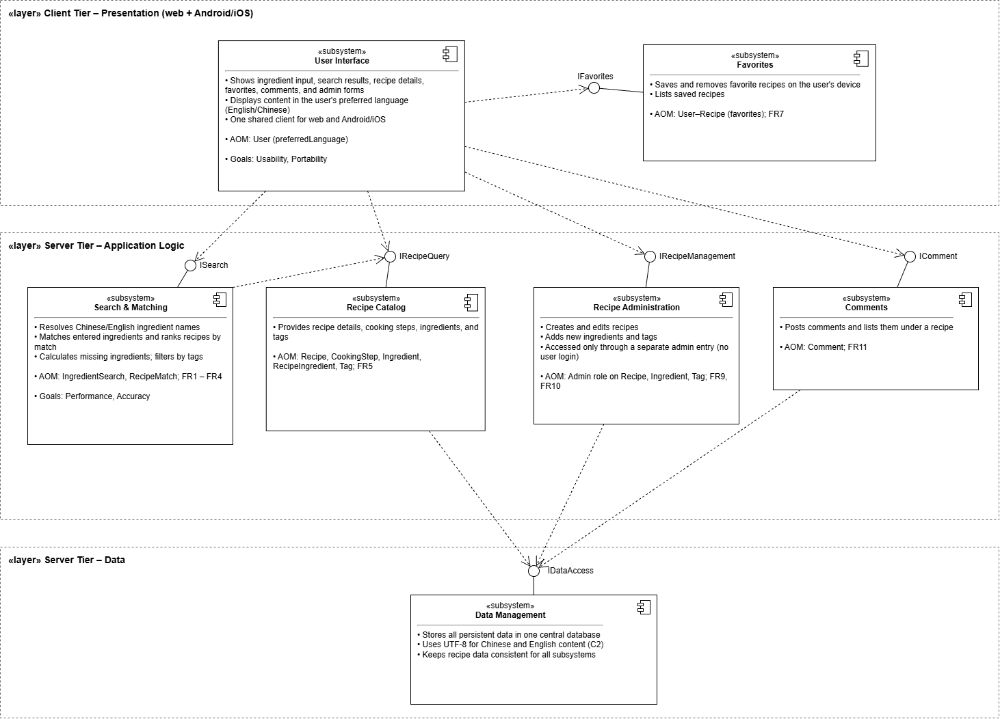
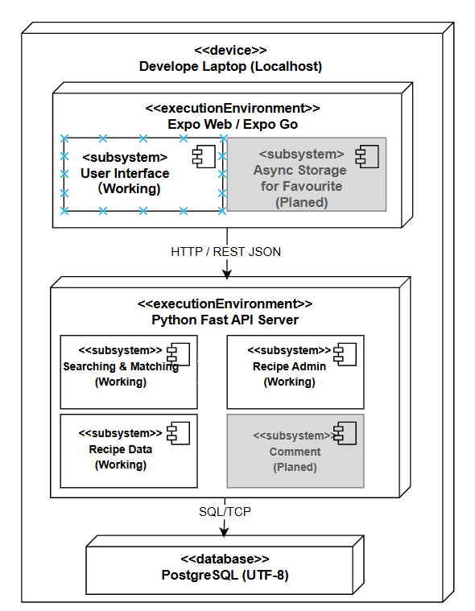

# CS1530_Project_Team_Falcons
Chinese Cuisine Knowledge Base

Team name: Team Falcons

Team members:

1.Mingyu Chen

2.Jiakai Dai

3.Haoyang Sun

4.Runxi Lao

Project Purpose: Chinese Cuisine Knowledge Base helps college students and young adults who cook at home decide what to make with the ingredients they already have. Users enter their available ingredients, and the system returns Chinese recipes ranked by how well they match, shows which ingredients are missing, and provides step-by-step cooking instructions. Users can also filter recipes by regional cuisine or dietary restriction, save favorites, and comment on recipes, while administrators maintain the accuracy of the recipe database.

We plan to build the system as a responsive web application and an Android/iOS mobile app using React Native with Expo, so that both clients can share most of the same code. Both clients will communicate with a shared backend API built with Python and FastAPI, and recipe data will be stored in a PostgreSQL database with UTF-8 encoding to support Chinese and English content. One thing we are unsure about is how to reliably match ingredient names entered in Chinese and in English, including synonyms and regional naming differences, to the same ingredient in our database.

## Tech Stack

| Layer | Technology |
|---|---|
| Languages | JavaScript (client), Python (server), SQL / PostgreSQL (data) |
| Frontend | React Native + Expo (web + Android/iOS), i18next (English/Chinese), AsyncStorage (favorites on the device) |
| Backend | Python 3.12+ with FastAPI, served by Uvicorn |
| Database | PostgreSQL with UTF-8 encoding |
| APIs / External services | None for the MVP (recipe data is imported into our own database once) |
| Deployment / Hosting | Render (backend, HTTPS), Expo web, Expo Go (demo on phones) |

## Architecture

### Subsystem decomposition (Sprint 3)



The system follows a three-layer client-server architecture: a client tier (presentation), a server tier for application logic, and a server tier for data.

### Deployment diagram (Sprint 4)



During development everything runs on the developer's laptop: the Expo client calls the FastAPI server over HTTP/REST (JSON), and the server talks to PostgreSQL over SQL/TCP.

### Which folder contains which subsystem

| Layer | Subsystem (Sprint 3) | Folder | Status |
|---|---|---|---|
| Client tier | User Interface | `frontend/ui/` | Placeholder (`.gitkeep`) |
| Client tier | Favorites | `frontend/favorites/` | Placeholder (`.gitkeep`) |
| Server tier – application logic | Search & Matching | `backend/search_matching/` | Skeleton router with `GET /health` |
| Server tier – application logic | Recipe Catalog | `backend/recipe_catalog/` | Skeleton router with `GET /recipes/health` |
| Server tier – application logic | Recipe Administration | `backend/recipe_admin/` | Placeholder (`.gitkeep`) |
| Server tier – application logic | Comments | `backend/comments/` | Placeholder (`.gitkeep`) |
| Server tier – data | Data Management | `backend/data_management/` | Placeholder (`.gitkeep`) |

Other files:

- `backend/main.py` – FastAPI entry point; creates the app and registers the subsystem routers.
- `backend/requirements.txt` – pinned Python dependencies.
- `docs/` – diagrams (`docs/images/`) and the skeleton test logs from team members.

```
CS1530_Project_Team_Falcons/
├── backend/
│   ├── main.py
│   ├── requirements.txt
│   ├── search_matching/     # Search & Matching
│   ├── recipe_catalog/      # Recipe Catalog
│   ├── recipe_admin/        # Recipe Administration
│   ├── comments/            # Comments
│   └── data_management/     # Data Management
├── frontend/
│   ├── ui/                  # User Interface
│   └── favorites/           # Favorites
├── docs/
│   ├── images/
│   └── sprint4-*-test.txt
├── user-stories.md
└── README.md
```

## How to Run the Skeleton

### Prerequisites

- Python 3.12 or newer (tested with Python 3.12.7 and 3.13.4)
- pip (comes with Python)
- Git
- No database, Node.js or API key is needed for the current skeleton.

Dependencies (installed in step 3): FastAPI 0.162.2 and Uvicorn 0.54.0.

### 1. Clone the repository

```bash
git clone https://github.com/CmyzzZ/CS1530_Project_Team_Falcons.git
cd CS1530_Project_Team_Falcons
```

### 2. Create and activate a virtual environment

Windows (PowerShell):

```powershell
python -m venv .venv
.venv\Scripts\Activate.ps1
```

Windows (Git Bash):

```bash
python -m venv .venv
source .venv/Scripts/activate
```

macOS / Linux:

```bash
python3 -m venv .venv
source .venv/bin/activate
```

### 3. Install the dependencies

```bash
pip install -r backend/requirements.txt
```

### 4. Start the server

Run this from the repository root (the folder that contains `backend/`), not from inside `backend/`:

```bash
python -m uvicorn backend.main:app --host 127.0.0.1 --port 8000
```

You should see:

```
INFO:     Application startup complete.
INFO:     Uvicorn running on http://127.0.0.1:8000 (Press CTRL+C to quit)
```

Press `Ctrl+C` to stop the server.

### 5. Check that it works

With the server running, open these URLs in a browser, or use `curl` in a second terminal:

| Subsystem | Request | Expected response |
|---|---|---|
| Search & Matching | `GET http://127.0.0.1:8000/health` | `200 OK`, `{"status":"ok"}` |
| Recipe Catalog | `GET http://127.0.0.1:8000/recipes/health` | `200 OK`, `{"status":"ok"}` |

```bash
curl http://127.0.0.1:8000/health
```

```bash
curl http://127.0.0.1:8000/recipes/health
```

You can also open the interactive API docs at <http://127.0.0.1:8000/docs>; both endpoints are listed there under "Search & Matching" and "Recipe Catalog".

### Troubleshooting

- `ModuleNotFoundError: No module named 'backend'` – you started Uvicorn from inside `backend/`. Go back to the repository root and run the command again.
- `python` is not found on macOS/Linux – use `python3` instead.
- PowerShell blocks `Activate.ps1` – run `Set-ExecutionPolicy -Scope CurrentUser RemoteSigned` once, or use Git Bash.
- Port 8000 is already in use – start with `--port 8001` and use that port in the URLs.

### Secrets

Do not commit passwords or API keys. `.env` is ignored by Git. When the database connection is added, settings such as the database URL will be documented in `.env.example`; copy it to `.env` and fill in your own values.

## What Works So Far

- The FastAPI backend starts locally with Uvicorn.
- Search & Matching: `GET /health` returns `{"status":"ok"}`.
- Recipe Catalog: `GET /recipes/health` returns `{"status":"ok"}`.
- The folder structure matches all seven subsystems from the Sprint 3 decomposition.
- The skeleton was run on Windows with Python 3.13.4 and Python 3.12.7 (see `docs/sprint4-*-test.txt`).

## What Does Not Work Yet

- No real recipe search, ingredient matching or recipe details yet; the two endpoints are only health checks.
- Recipe Administration, Comments and Data Management are empty placeholder folders.
- No PostgreSQL schema or database connection yet, so no data is stored.
- No frontend yet: the React Native + Expo app (User Interface and Favorites) has not been created.
- Nothing is deployed to Render yet; the skeleton only runs locally.
